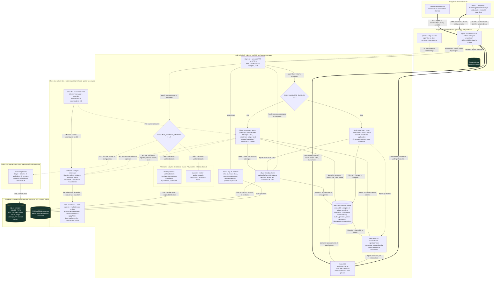
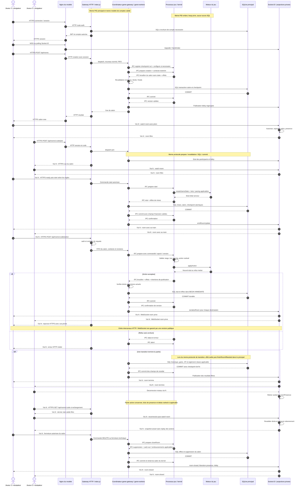

# Architecture multijoueur de KTGA

Audit documentaire des **28–29 octobre 2026**, réalisé à partir du dépôt local, HEAD `56845cd72e185373f79b334e341c0fac5a83debd`. Le répertoire contient également des modifications de travail préexistantes ; cet audit n'en modifie aucune. Aucun test de charge ni changement de production n'a été effectué pour cet audit.

La capacité et les recommandations sont détaillées dans [l'audit de performances](audit_performances_multijoueur.md). Le [diagramme principal autonome](architecture_multijoueur.mmd) peut être ouvert dans un visualiseur Mermaid ; il décrit l'existant, avec ses modes conditionnels.

## 1. Conclusions de lecture

KTGA est une application Node.js avec **un point de coordination principal** : HTTP, Socket.IO, comptes en mémoire, présence, matchmaking et écritures métier. Deux modes d'exécution des salons coexistent :

1. **Historique**, lorsque `GAME_WORKERS_ENABLED` n'est pas `1` : les commandes et les moteurs tournent dans le processus principal.
2. **Processus de jeu**, lorsque ce drapeau vaut `1` : un pool de **1 à 4 processus enfants** exécute les transitions. Un salon a un seul propriétaire dans ce pool. Le principal prépare le contexte, contrôle les effets, écrit SQLite et diffuse les vues ; le worker n'écrit pas la base.

Les joueurs **envoient leurs actions par HTTP POST**. Socket.IO transporte surtout les abonnements, les états filtrés et les événements. Il n'existe pas dans le chemin examiné de serveur WebSocket autonome qui hébergerait les règles. Les modèles 3D et leurs animations sont rendus dans le navigateur ; les moteurs serveur manipulent des données de jeu.

**Preuves :** [index.js](../server/src/index.js), `createAppServer`, construction de `io`, `dispatchRoomCommand`, initialisation de `gameGateway` ; [RoomPage.jsx](../client/src/pages/RoomPage.jsx), effet Socket.IO et fonction `action` ; [game-workers.js](../server/src/services/game-workers.js), `createGameWorkers` ; [engines.js](../server/src/games/engines.js), `createGameState` et `applyAction`.

## 2. Périmètre et niveau de certitude

| Qualification | Signification dans ce document |
| --- | --- |
| Constat de code | Comportement visible dans les fichiers et fonctions cités ; ne prouve pas qu'une option est active en production. |
| Modèle de déploiement | Configuration fournie sous `deploy/debian/` ; son application exacte aujourd'hui n'a pas été vérifiée sur le serveur. |
| Mesure historique | Résultat daté et scénario identifié ; ne certifie pas la révision courante. |
| Risque ou proposition | Déduction explicitement séparée du fonctionnement implémenté. |

Le [compte rendu d'activation du 10 octobre](previews/game-processes-live-20261010/checks.json) indique alors un gateway, un processus de jeu et l'option comptes désactivée, à la révision `7d5d249`. Il ne permet pas d'affirmer les drapeaux, le matériel ou les PID du 28 octobre. Aucun inventaire de production actuel n'est inféré de ce rapport.

Le dépôt ne démontre pas la présence d'un cluster Node, d'un adapter Socket.IO distribué, de Redis, de PostgreSQL, d'un bus durable ni d'une coordination intermachines pour les salons. Le commentaire « Redis can implement this contract » de `GameIpcTransport` décrit une possibilité d'extension, pas une intégration existante.

## 3. Processus, threads et responsabilités

| Composant | Frontière d'exécution | Mémoire et autorité | Indépendance réelle |
| --- | --- | --- | --- |
| Nginx du modèle Debian | Processus distincts de Node | TLS, fichiers statiques, connexions proxy | Peut être redémarré séparément ; ne conserve pas les parties. |
| `index.js` | Un processus Node principal | Comptes, salons validés, présence, invités, files ranked, écritures SQLite, API et Socket.IO | Autorité centrale ; son arrêt coupe l'API et les connexions temps réel. |
| `game-worker-process.js` | 1 à 4 enfants `fork`, si activés | Un kernel, une `Map` de salons et une boucle événementielle par enfant ; brouillons et reçus privés | Remplaçables individuellement ; nécessitent le parent pour les commandes, les commits et le réseau. |
| `accounts-process.js` | Un enfant `fork`, optionnel | Lectures SQL et projections de comptes, bcrypt, caches propres | Pas d'autorité d'écriture ; ne remplace pas le gateway. |
| `reading-worker.js` | `worker_threads`, lorsque l'option comptes est désactivée | Isolate/heap propre dans le même PID ; connexion SQLite en lecture seule | Décharge les lectures, pas les mutations de salon. |
| `password-worker.js` | `worker_threads`, alternative à bcrypt du processus comptes | Isolate/heap propre ; tâches de hash/compare | Pool créé à la demande ; pas un moteur de jeu. |
| SQLite principal | Fichier local ouvert par plusieurs connexions | Source durable des comptes, checkpoints et résultats | Les connexions de lecture ne partagent pas les objets JS du principal. |
| SQLite annexes | Fichiers et connexions de services | Chat, journaux, statut et autres données transverses | Une transaction principale ne rend pas automatiquement atomiques les autres fichiers. |

Les moteurs sont des **modules importés**, pas quinze services ou quinze processus. Les différents enfants n'ont ni `Map` commune ni heap partagé. Les threads de lecture ne doivent pas être confondus avec des processus de jeu ou le pool interne libuv de Node.

**Preuves :** [game-ipc-transport.js](../server/src/services/game-ipc-transport.js), constructeur `GameIpcTransport` ; [game-worker-process.js](../server/src/services/game-worker-process.js), instance `kernel` et gestionnaire `message` ; [accounts-work.js](../server/src/services/accounts-work.js), `createAccountsWork` ; [process-worker.js](../server/src/services/process-worker.js), `ProcessWorker` ; [reading-work.js](../server/src/services/reading-work.js), `createReadingWork` ; [password-work.js](../server/src/services/password-work.js), `createPasswordWork` ; [ktga.service](../deploy/debian/ktga.service), `ExecStart` et politique de redémarrage.

### 3.1 Options qui changent la topologie

| Option lue par le code | Comportement |
| --- | --- |
| `GAME_WORKERS_ENABLED=1` | Active le coordinateur et les processus de jeu ; sinon chemin historique. |
| `GAME_WORKERS` | `1` par défaut dans `index.js`, validation de 1 à 4 dans `createGameWorkers`. Ce nombre n'est pas un nombre de salons maximum. |
| `ACCOUNTS_PROCESS_ENABLED=1` | Remplace les services de lecture et de mots de passe concernés par le processus comptes partagé. Option indépendante du mode jeux. |
| `READING_WORKERS` | `1` par défaut pour le pool alternatif de lecture ; pool générique limité à 1–4. |
| `SQLITE_PATH` | Fichier principal ; sinon `server/data/ktga.sqlite`. |
| `SQLITE_SYNCHRONOUS` | `FULL` par défaut ; seules valeurs admises : `FULL`, `NORMAL`. |
| `APP_BASE_PATH` et configuration réseau | Préfixent notamment le chemin Socket.IO ; HTTPS direct possible si certificats configurés. |

Le pool de mots de passe exporté utilise par défaut `availableParallelism() - 1`, borné entre 1 et 4. Il ne faut pas déduire son dimensionnement de la seule existence d'une variable dans un exemple ou une liste de paramètres : le constructeur et son appel effectif font foi.

**Preuves :** [index.js](../server/src/index.js), initialisation de `accountsWork`, `readingWork`, `gameGateway` et `createAppServer` ; [task-pool.js](../server/src/services/task-pool.js), `createTaskPool` ; [sqlite-settings.js](../server/src/storage/sqlite-settings.js), `sqliteSettings`.

### 3.2 Exécutions annexes hors du flux des parties

`generatePersonalArchive()` crée à la demande un `worker_threads` pour produire une archive personnelle, avec limite de durée ; ce worker n'exécute pas de salon. Le superviseur `createCapacityTests()` peut lancer par `fork` le runner administratif de capacité, qui organise une instance fictive isolée et son générateur. Ces exécutions sont distinctes des workers de jeu ; elles ne prouvent ni un deuxième gateway public permanent ni un mécanisme de répartition des joueurs. Les scripts de construction, migration et déploiement sont également des tâches d'exploitation, pas des propriétaires de salons. Ces tâches périphériques sont omises du diagramme principal pour garder lisible le chemin multijoueur.

**Preuves :** [data-requests.js](../server/src/services/data-requests.js), `generatePersonalArchive` ; [personal-archive-worker.js](../server/src/services/personal-archive-worker.js), traitement de `workerData` ; [capacity-tests.js](../server/src/services/capacity-tests.js), `createCapacityTests` ; [admin-runner.mjs](../server/scripts/capacity/admin-runner.mjs), lancement du test isolé.

## 4. Diagramme principal : architecture implémentée

Les sous-graphes délimitent les processus ou les mémoires. Les branches « oui/non » représentent des alternatives de configuration. Une flèche vers SQLite est un accès SQL, jamais un partage de heap. Les libellés distinguent HTTP, WebSocket/polling, IPC et appels mémoire ; les traits épais indiquent les échanges temps réel et les pointillés les messages ou la supervision OS.

<!-- MAIN_DIAGRAM_START -->

<!-- MAIN_DIAGRAM_END -->

Le diagramme est une synthèse des fonctions citées dans les sections 3, 5 à 10. Les réponses HTTP et les résultats des tâches reviennent sur les mêmes canaux ; toutes les flèches de retour ne sont pas répétées. Le groupe jeux représente plusieurs instances équivalentes, chacune avec sa propre mémoire. Aucun worker de jeu ne possède de socket navigateur.

## 5. Réseau, authentification et routage

### 5.1 Entrées HTTP et reverse proxy

`createAppServer()` instancie HTTP, ou HTTPS direct si la configuration de certificats le demande. Express et Socket.IO partagent ce serveur. L'API est routée par chemin ; la table est trouvée à partir du `:code`, puis le coordinateur utilise son identifiant interne. Le port d'écoute et l'adresse sont configurables ; le modèle Nginx fourni cible un **seul upstream** `127.0.0.1:4000`.

Nginx termine TLS, sert notamment les assets construits et proxyfie l'API et les connexions temps réel. Le modèle comporte aussi des réécritures `/discord-activity/api/` et `/discord-activity/socket.io/`. Les délais varient selon les blocs : il faut examiner la location réellement utilisée, plutôt que supposer un délai global. Aucune répartition des salons entre plusieurs machines n'est mise en œuvre par cette configuration.

Principales entrées :

| Entrée | Rôle et exécution |
| --- | --- |
| `POST /api/auth/guest`, routes de connexion, `GET /api/me` | Identité et session ; principal, éventuellement bcrypt/projections délégués. |
| `GET /api/rooms`, `GET /api/rooms/:code` | Liste synthétique ou vue privée d'un salon validé ; principal. |
| `POST /api/rooms` | Création du salon, sans état de partie initialement. |
| `POST /api/rooms/:code/join`, `/spectate`, `/ready`, `/start` | Participation et lancement ; commandes historiques ou déléguées. |
| `POST /api/rooms/:code/action` | Validation et transition du jeu ; réponse HTTP contenant une vue. |
| `/replay`, `/leave`, `/kick`, `/game-settings`, `/poker-settings`, `/battle-settings`, `/level-settings`, `/pacing/skip` sous `/api/rooms/:code` | Gestion de la table et de son rythme ; droits vérifiés par commande. |
| `DELETE /api/rooms/:code` et route administrative correspondante | Fermeture selon les autorisations ; chemin commun de commandes. |
| `/api/ranked/*` | File, propositions et acceptations dans le principal ; transitions du match déléguées si activées. |
| Chemin `${APP_BASE_PATH}/socket.io` | Protocole Socket.IO/Engine.IO, distinct de l'API d'actions. |

**Preuves :** [index.js](../server/src/index.js), `createAppServer`, `dispatchRoomCommand`, enregistrement des routes et `server.listen` ; [room-commands.js](../server/src/services/room-commands.js), `createRoomCommands` et sa `Map` de commandes ; [nginx-common.conf](../deploy/debian/nginx-common.conf), upstream `ktga_backend` ; [nginx-https.conf](../deploy/debian/nginx-https.conf), blocs `location` et `proxy_pass`.

### 5.2 Sessions et autorisations

`makeToken()` produit un JWT HS256 comprenant `id`, `guest` et `sessionVersion`, expiration par défaut `7d`. `auth()` accepte le jeton de session via les mécanismes de requête prévus, vérifie sa signature, puis l'état actuel du compte : existence, version de session, activation, modération, restrictions parentales et, selon les routes, adresse email. Le JWT ne remplace donc pas les contrôles de compte.

Les comptes inscrits sont durables dans SQLite. La `Map sessions` contient en revanche les **comptes invités**, créés par `POST /api/auth/guest`. Elle n'est pas un registre durable de toutes les connexions. `getUser()` consulte d'abord cette Map, puis les utilisateurs du modèle chargé. Un redémarrage du principal perd les invités et leur continuité n'est pas garantie, même si un salon mentionne encore leur identifiant.

Le constructeur Socket.IO applique une politique d'origine et CORS. L'autorisation d'un salon a lieu dans `watch-room`, avec vérification du JWT et des droits actuels. `subscribeToChat` applique aussi ses contrôles ; le canal de conversation exige un compte inscrit autorisé. Le coordinateur réévalue `validateActor()` avant de valider les effets d'une commande déléguée.

**Preuves :** [index.js](../server/src/index.js), `makeToken`, `auth`, `getUser`, route `POST /api/auth/guest`, `subscribeToChat`, gestionnaire `watch-room` et dépendance `validateActor` de `createGameGateway`.

### 5.3 Abonnements Socket.IO

- Le lobby reçoit une liste initiale `rooms` et, pour les clients qui annoncent `lobbyDeltas`, les changements incrémentaux. Le regroupement évite un envoi pour chaque mutation intermédiaire.
- `watch-room` rejoint le groupe de la table et le chat associé, quitte les groupes du lobby concernés et inscrit le socket dans `roomPresence`. Il envoie immédiatement une vue complète filtrée.
- Un flux de conversation séparé rejoint notamment `account:<userId>`, relaie les messages, les notifications de présence et les invalidations d'inbox. Un utilisateur n'équivaut donc pas nécessairement à une seule connexion réseau.
- Les rôles assis et spectateur sont distincts. `maySpectate()` autorise les participants, les salons publics sans mot de passe ou un accès accordé temporairement ; les règles ranked peuvent interdire les spectateurs. `spectatorAccess` est une Map mémoire avec expiration, pas une permission persistée.

**Preuves :** [index.js](../server/src/index.js), `io.on("connection")`, `grantSpectatorAccess`, `maySpectate`, `roomPresence` ; [lobby-broadcast.js](../server/src/services/lobby-broadcast.js), `createLobbyBroadcast` ; [useConversationInbox.js](../client/src/components/social/useConversationInbox.js), `useConversationInbox` ; [LobbyPage.jsx](../client/src/pages/LobbyPage.jsx), effet Socket.IO ; [SpectatorPage.jsx](../client/src/pages/SpectatorPage.jsx), abonnement `watch-room`.

## 6. Salons, états et moteurs

### 6.1 Cycle métier commun

Un salon est un objet persistant avec identifiant, code, jeu, propriétaire, liste de participants, paramètres d'accès, mise, prêts et horodatages. À la création, `state` est `null`. Le fait d'entrer ou de regarder une table ne lance pas le moteur.

Le lancement vérifie droits, joueurs, paramètres et fonds. `startRoomRound()` prélève les mises applicables aux joueurs financés, initialise `createGameState(gameId, players, options)`, affecte l'identifiant d'activité et prépare les tours de bots. Les validations spécifiques restent dans les moteurs, sous le contrôle des commandes de salon. Les invités/bots ne doivent pas être assimilés à des dépôts réels de comptes financés.

Une action passe par les contrôles d'appartenance au salon, de tour, de pacing et, pour le classé, `validateRankedAction()`, puis `applyAction()`. Les moteurs opèrent sur l'état serveur. Leurs exceptions deviennent des refus métier ; le client n'est pas autorité sur le tirage ou le résultat. Le pacing de bots, de fin de tour et de résultats est un état serveur ; certaines actions de dés ont également un délai de disponibilité de 700 ms.

`finishRoomIfNeeded()` gère la clôture métier : gains, progression, historique et éventuel règlement classé. Un état de jeu fini et un salon détruit sont deux événements différents. Une table terminée peut rester disponible pour les résultats ou un replay. La fermeture passe par `closeRoom()` avec les règles de remboursement/cash-out adaptées au motif et au jeu.

**Preuves :** [room-commands.js](../server/src/services/room-commands.js), handlers création, `join`, `start`, `action`, `replay` ; [room-runtime.js](../server/src/services/room-runtime.js), `startRoomRound`, `runBotTurns`, `startRoomPacing`, `advanceRoomPacing` ; [index.js](../server/src/index.js), `finishRoomIfNeeded`, `addTokens` ; [room-economy.js](../server/src/services/room-economy.js), `fundedRoomPlayers`, `classicRoomPayouts`, `pokerRoomPayouts` ; [room-lifecycle.js](../server/src/services/room-lifecycle.js), `closeRoom`.

### 6.2 Registre des quinze jeux

[engines.js](../server/src/games/engines.js) possède deux `Map` : `gameFactories` et `gameActions`. `createGameState()` et `applyAction()` sélectionnent une fonction selon l'identifiant du jeu. Les modules sous [games/engines/](../server/src/games/engines) couvrent :

| Identifiants | Responsabilité |
| --- | --- |
| `yahtzee`, `421`, `cul-de-chouette`, `farkle`, `liars-dice`, `shut-the-box`, `midnight-dice` | États et actions des jeux de dés ; les informations privées sont filtrées séparément. |
| `blackjack`, `texas-holdem`, `president`, `bataille`, `belote`, `velvet-ruse`, `golf-solitaire`, `accordion` | États et actions des jeux de cartes ; `tickPokerState` et `tickBattleState` couvrent aussi des transitions temporisées. |

Le registre est réutilisé dans les deux modes. Le kernel construit un environnement de dépendances compatible avec `room-commands`, `room-runtime` et `ranked-room-runtime` : mêmes règles, accès aux comptes limité au contexte et collecte d'effets au lieu d'écritures directes. Il ne crée pas une nouvelle version des quinze moteurs. `appendLog()` limite le journal courant de jeu à 80 entrées ; cela ne fixe pas à lui seul une taille maximale de tout l'état.

**Preuves :** [game-room-kernel.js](../server/src/services/game-room-kernel.js), `prepareTransition` et construction des dépendances ; [engine-context.js](../server/src/games/engine-context.js), `appendLog`.

### 6.3 Matchmaking et horloges

`createRankedRuntime()` conserve `queue` et `offers` dans deux Maps du principal. Son `tick()` est appelé toutes les deux secondes. Il vérifie les inscriptions et confirmations, expire les entrées dont le heartbeat est trop ancien et forme les groupes. Avec `roomDriver`, le démarrage et l'annulation du match sont délégués ; la file de recherche reste dans le principal.

Dans le mode historique, un intervalle principal d'une seconde traite les échéances générales des salons. Dans le mode processus, chaque enfant appelle `kernel.due()` chaque seconde et signale les salons à traiter. Le gateway déduplique les ticks et les soumet comme des commandes normales : le worker ne valide pas seul un résultat périodique. Poker, Bataille et parties ranked actives peuvent être examinés chaque seconde même sans action humaine.

`ranked-room-runtime.tickRoom()` applique les délais d'absence et d'AFK ainsi que les forfaits. Les durées sont issues de la configuration du match, pas d'un délai unique commun à tous les jeux.

**Preuves :** [ranked-runtime.js](../server/src/services/ranked-runtime.js), `createRankedRuntime`, `match`, `tick` ; [ranked.js](../server/src/services/ranked.js), `matchQueue`, `queueGroupFor` ; [ranked-room-runtime.js](../server/src/services/ranked-room-runtime.js), `tickRoom` ; [game-worker-process.js](../server/src/services/game-worker-process.js), intervalle `due` ; [game-room-kernel.js](../server/src/services/game-room-kernel.js), `due` et branche `tick` ; [index.js](../server/src/index.js), intervalles ranked et historique.

## 7. Protocole de transition multiprocessus

### 7.1 Attribution et ordre

`createGameWorkers()` attribue un nouveau salon au processus vivant ayant le moins de salons. La mesure est un **nombre de salons**, pas une estimation de coût CPU. Aucune migration proactive ou pondération par jeu n'est visible dans cette attribution.

Une chaîne de Promises impose une FIFO par `roomId`. Des salons différents peuvent avoir des requêtes en vol simultanément, mais un enfant Node reste doté d'une boucle JavaScript : 16 messages IPC en vol ne signifient pas 16 exécutions CPU parallèles. L'annuaire du principal indexe les salons par identifiant, code et membres.

**Preuves :** [game-workers.js](../server/src/services/game-workers.js), `ownership`, `execute` et `chains` ; [room-directory.js](../server/src/services/room-directory.js), `createRoomDirectory`, `refresh`, `related`, `committed` ; [game-ipc-transport.js](../server/src/services/game-ipc-transport.js), `dispatch`.

### 7.2 Étapes d'une commande

1. Le principal résout le salon, choisit son propriétaire et enregistre au besoin le dernier checkpoint avec `register`. Il transmet la configuration quand sa révision change.
2. `game-gateway.context()` rassemble une vue restreinte des comptes pertinents, autorisations, sockets et conflits ranked. Il capture les révisions du salon, des comptes et de la configuration. Il ne copie pas toute la base dans chaque enfant.
3. `prepare` vérifie `epoch`, version et `commandId`. Le kernel clone son état validé et le contexte, exécute la commande et produit un brouillon, des effets et des intentions d'événements. Un brouillon n'est pas une mutation durable.
4. Le callback `commit` du gateway vérifie à nouveau les révisions, droits et fonds. Un garde empêche une mutation de salon hors du `roomId` autorisé. `updateDb()` persiste les effets métier et le checkpoint dans la transaction principale.
5. Après le COMMIT SQLite, le principal envoie `commit` au worker, avec les champs financiers/résultats recalculés. Le kernel promeut le brouillon et incrémente sa version.
6. Le gateway publie les événements et les vues filtrées, puis répond à la requête HTTP. Les ticks sans changement et les refus non écrits empruntent `abort` au lieu de provoquer un commit inutile.

Ce protocole n'est **pas** un consensus distribué ni une transaction préparée SQLite dans le worker. L'autorité durable est le principal ; le worker ne peut pas valider seul des jetons. L'`epoch` protège le protocole local d'un propriétaire devenu obsolète, sans constituer un lease durable intermachines.

**Preuves :** [game-gateway.js](../server/src/services/game-gateway.js), `createGameGateway`, callbacks `context`, `commit`, `execute`, `dispatch` ; [game-workers.js](../server/src/services/game-workers.js), `run` ; [game-room-kernel.js](../server/src/services/game-room-kernel.js), `register`, `prepareTransition`, `commit`, `abort` ; [db.js](../server/src/db.js), `setRoomMutationGuard`, `updateDb`, `persistDatabase`.

### 7.3 Queues et isolation

| Protection implémentée | Valeur par défaut / portée |
| --- | --- |
| Admission de commandes jeux | 512 opérations admises au total, dont celles en cours ; maximum 8 par salon. |
| Transport IPC d'un enfant | File d'attente de 256 requêtes, 16 en vol ; expiration de 10 s à partir de la mise en file. |
| Réessai de conflit | Au plus 3 tentatives au niveau gateway, uniquement pour une erreur marquée réessayable avant validation durable. |
| Reçus du kernel | 32 `commandId` récents par salon en mémoire ; le dernier checkpoint durable peut réamorcer le reçu au réenregistrement. |
| Processus comptes | File d'attente de 512, limite par clé 8 dans le pool partagé, délai de 10 s ; 256 tâches en vol possibles, pas 256 cœurs. |
| Pool alternatif de lecture | File d'attente de 128, limite par clé 8, délai 10 s, taille 1 par défaut. |
| Pool alternatif bcrypt | File bornée à 128 par défaut, taille CPU bornée 1–4. |

`GAME_BUSY` et les autres erreurs `GAME_*` deviennent généralement des réponses 503 avec `Retry-After`, sauf conflit 409 et révocation 403. Ce sont des refus explicites, pas une promesse de traitement ultérieur. Les messages IPC utilisent la sérialisation avancée de Node. Les files sont bornées en **nombre**, sans budget explicite d'octets dans ce transport.

L'environnement transmis aux processus enfants est réduit : pas de secret JWT, SMTP ou chargement volontaire de `db.js` dans le worker de jeu. Cette isolation est une séparation de code et d'environnement, **pas une sandbox OS par salon** : les enfants héritent notamment de l'identité système du service.

**Preuves :** [game-workers.js](../server/src/services/game-workers.js), `createGameWorkers`, `execute` ; [game-ipc-transport.js](../server/src/services/game-ipc-transport.js), constructeur et `request` ; [game-room-kernel.js](../server/src/services/game-room-kernel.js), `commit` ; [accounts-work.js](../server/src/services/accounts-work.js), `createAccountsWork` ; [task-pool.js](../server/src/services/task-pool.js), admission ; [index.js](../server/src/index.js), middleware d'erreurs `GAME_*` ; [ktga.service](../deploy/debian/ktga.service), `User` et protections système.

## 8. Diagramme de séquence : vie d'une partie

Ce scénario montre **le mode processus de jeu activé**. `G`, `P` et `S` sont trois responsabilités du **même PID principal** ; `W` et `E` partagent le PID du worker propriétaire. Le proxy est celui du modèle Debian ; en accès Node direct, sa ligne disparaît. Pour garder le diagramme lisible, les publications de chaque commande de préparation de table sont regroupées par notes ; les actions et les retours réseau restent distingués.

La sauvegarde de fin n'est pas un traitement autonome après la réponse : l'encart représente les effets **à l'intérieur de la transition qui termine la partie**. Les modalités de ready, lancement, action et paiement varient selon le jeu et le mode classé. En mode historique, les appels à `P`/`W` sont remplacés par les handlers et moteurs locaux ; ils utilisent la même couche de persistance et de diffusion.

**Preuves du scénario :** [room-commands.js](../server/src/services/room-commands.js), handlers HTTP ; [game-gateway.js](../server/src/services/game-gateway.js), `dispatch`, `execute`, `commit` ; [game-workers.js](../server/src/services/game-workers.js), `run` ; [room-runtime.js](../server/src/services/room-runtime.js), `startRoomRound` ; [index.js](../server/src/index.js), `finishRoomIfNeeded`, `emitRoomUpdate`, `watch-room`, `disconnect` ; [room-lifecycle.js](../server/src/services/room-lifecycle.js), `closeRoom` ; [RoomPage.jsx](../client/src/pages/RoomPage.jsx), chargement, action et reconnexion.

## 9. Persistance et état mémoire

### 9.1 Base principale

`db.js` ouvre `node:sqlite.DatabaseSync`. Les pragmas activent WAL, les clés étrangères, un `busy_timeout` de 5 000 ms, `synchronous=FULL` par défaut, un auto-checkpoint à 1 000 pages et un cache configuré à environ 20 000 Kio. Ce sont des réglages, pas des mesures de débit.

`loadDatabase()` charge les comptes et salons dans `cachedDb`. `readDb()` renvoie ce modèle mémoire ; il ne recharge pas tous les salons par SQL à chaque requête. Les états complets des salons sont persistés en JSON. Les historiques et transactions sont représentés par des archives à chargement/requête différé, et des données de comptes/progression sont normalisées dans des tables spécifiques.

`snapshotCollections()` garde aussi des représentations JSON et références pour comparer les mutations. `persistDatabase()` construit les changements, exécute `BEGIN IMMEDIATE`, applique insertions/suppressions/archives et COMMIT. Les sélections de lignes et `settings:false` réduisent le travail ; les collections non explicitement restreintes peuvent encore être parcourues. Sur exception, `restoreCommittedState()` recharge le dernier état validé.

Le checkpoint `room.gameWorker` contient version, `commandId`, `epoch` et `workerId`. Il est écrit avec les effets métier de la transaction principale. Le registre des propriétaires vivants et les chaînes FIFO restent mémoire ; un identifiant de worker dans SQLite n'est pas une preuve qu'un processus est encore propriétaire.

**Preuves :** [db.js](../server/src/db.js), initialisation, `loadDatabase`, `readDb`, `snapshotCollections`, `persistDatabase`, `updateDb`, `restoreCommittedState`, `databaseEntityRevision` ; [sqlite-settings.js](../server/src/storage/sqlite-settings.js), `sqliteSettings` ; [normalized.js](../server/src/storage/normalized.js), `createNormalizedStorage` ; [archives.js](../server/src/storage/archives.js), `Archive` ; [selected-rows.js](../server/src/storage/selected-rows.js), `selectedCollectionRows` ; [game-gateway.js](../server/src/services/game-gateway.js), callback `commit`.

### 9.2 Lectures déléguées et autres fichiers

`createReadingTasks()` ouvre une connexion en lecture seule, `query_only=ON`, délai d'attente de 1 000 ms et cache réduit. Les lectures historique/ledger/statistiques utilisent une transaction de lecture et `PRAGMA data_version` pour leurs révisions de cache. Le processus comptes étend cette séparation à des projections de comptes et à bcrypt ; **les écritures de comptes restent coordonnées dans le principal**.

Les stores de chat, journaux de requêtes, historique de statut, contrôle parental, tribunal, demandes de données, passkeys, communication ou historique d'exécution utilisent aussi SQLite selon leur initialisation. Le store Koins est construit via `useDatabase(createKoinStore)` et réutilise la connexion principale : il ne faut pas déduire « un fichier par fonctionnalité ». Les locales et les médias ont également du stockage fichier. Il n'existe pas de transaction distribuée automatique couvrant tous ces supports.

**Preuves :** [reading-tasks.js](../server/src/services/reading-tasks.js), `createReadingTasks` ; [accounts-process.js](../server/src/services/accounts-process.js), initialisation et exécution des tâches ; [index.js](../server/src/index.js), initialisation des stores et `useDatabase(createKoinStore)` ; [chat.js](../server/src/services/chat.js), `createChatStore` ; [request-logs.js](../server/src/services/request-logs.js), `createRequestLogStore` ; [status-monitor.js](../server/src/services/status-monitor.js), ouverture de base ; [data-requests.js](../server/src/services/data-requests.js), `createDataRequestStore` ; [passkey-store.js](../server/src/services/passkey-store.js), `createPasskeyStore`.

### 9.3 Résultats et unicité

Les effets de jetons, historique, XP, succès et résultats sont contrôlés dans le principal, notamment par `finishRoomIfNeeded()` ; certains jeux ont des paiements ou cash-outs spécifiques. La persistance normalisée possède des contraintes d'unicité sur les règlements ranked et leurs résultats ainsi que les reçus de récompenses. Ces contraintes protègent leurs domaines respectifs ; elles ne constituent pas une déduplication universelle de tous les POST HTTP.

**Preuves :** [index.js](../server/src/index.js), `finishRoomIfNeeded`, `addTokens` ; [normalized.js](../server/src/storage/normalized.js), tables `ranked_settlements`, `ranked_results`, `achievement_reward_receipts` ; [room-economy.js](../server/src/services/room-economy.js), calculs de paiements ; [game-gateway.js](../server/src/services/game-gateway.js), application des `effects`.

## 10. Déconnexion, reprise et garanties

### 10.1 Reconnexion d'un navigateur

`RoomPage` charge la table par HTTP, puis réémet `watch-room` à chaque `connect`. Le serveur revalide l'accès et renvoie le **dernier snapshot**, pas une relecture événement par événement. `SpectatorPage` suit le même principe. La présence active n'est pas déduite du JWT : elle dépend des sockets abonnés.

À la déconnexion, le socket est retiré de `roomPresence`. Un salon sans partie commencée peut être supprimé après 10 s sans socket dans ce chemin ; un nettoyage des salons d'attente emploie aussi un seuil de 30 s. Une partie active n'est pas immédiatement supprimée par cette règle. La présence générale utilise de son côté un délai de grâce de 5 s. Une heure d'inactivité métier peut fermer un salon avec les remboursements applicables ; ces délais répondent à des objectifs distincts.

Les délais ranked peuvent conduire à un forfait si l'absence ou l'AFK dépasse la configuration. À la reprise d'un checkpoint ranked, `register()` réinitialise certains marqueurs d'absence et de tour et accorde le délai prévu pour une échéance poker. La file de matchmaking, les propositions, les permissions spectateur temporaires et les invités ne sont pas restaurés depuis un journal durable.

**Preuves :** [RoomPage.jsx](../client/src/pages/RoomPage.jsx), effet `connect`/`watch-room` ; [SpectatorPage.jsx](../client/src/pages/SpectatorPage.jsx), effet Socket.IO ; [index.js](../server/src/index.js), `disconnect`, nettoyage des tables et `isWatching` ; [online-presence.js](../server/src/services/online-presence.js), `createOnlinePresence` ; [room-lifecycle.js](../server/src/services/room-lifecycle.js), `ROOM_INACTIVITY_MS`, `roomIsInactive`, `closeRoom` ; [game-room-kernel.js](../server/src/services/game-room-kernel.js), `register` et `expire` ; [ranked-room-runtime.js](../server/src/services/ranked-room-runtime.js), `tickRoom`.

### 10.2 Panne d'un processus

| Moment de la panne | Comportement prévu par le code | Limite de la garantie |
| --- | --- | --- |
| Worker arrêté avant COMMIT | Brouillon non durable abandonné ; ancien enfant terminé avant remplacement ; réenregistrement depuis le snapshot du principal. | L'appel HTTP peut échouer ; aucun succès ne doit être déduit de l'absence de réponse. |
| Worker arrêté après COMMIT, avant accusé IPC | Le coordinateur compare le checkpoint `commandId`/version, remplace le worker et reprend l'état durable sans réexécuter le callback financier déjà validé. | Garantie interne de ce protocole ; pas de reçu durable global pour tout retry HTTP externe. |
| Expiration IPC de 10 s | Arrêt de l'enfant et rejet des travaux de sa file et de ses requêtes en vol. | Plusieurs salons affectés simultanément ; une file bornée n'évite pas toutes les expirations. |
| Principal redémarré | SQLite recharge les salons ; `gameGateway.recover()` les traite séquentiellement par `tick` avant `listen`. Le modèle systemd redémarre le service en échec. | Connexions et Maps volatiles perdues ; durée de reprise à grand nombre de salons non mesurée. |
| Crash après COMMIT avant diffusion | Le snapshot durable existe et sera accessible par une nouvelle lecture/abonnement. | Pas d'outbox de publication ni de relecture garantie de tous les événements éphémères dans le chemin examiné. |

`shutdown()` ferme les coordinateurs et pools, avec une sortie forcée après 10 s ; l'unité fournie autorise 30 s avant arrêt systemd. Cette différence doit être testée avec une file chargée. Les processus enfants quittent aussi sur déconnexion du canal IPC.

Une fermeture présente un cas particulier : une fois la ligne du salon supprimée, le checkpoint porté par cette ligne n'existe plus. Si l'accusé IPC du `commit` de suppression est perdu, la branche de reprise fondée sur `snapshot(roomId)?.gameWorker` ne peut pas retrouver ce reçu ; elle peut renvoyer une erreur malgré une suppression et ses effets déjà durables. Aucun tombstone durable de fermeture n'est visible dans ce protocole. Ce cas mérite un test de panne dédié ; il ne démontre pas un double paiement observé.

**Preuves :** [game-workers.js](../server/src/services/game-workers.js), `ownership`, `run`, `close` ; [game-ipc-transport.js](../server/src/services/game-ipc-transport.js), `request`, `stop`, `terminate` ; [game-gateway.js](../server/src/services/game-gateway.js), `recover`, `execute` ; [index.js](../server/src/index.js), `shutdown` et `await gameGateway?.recover()` avant `listen` ; [ktga.service](../deploy/debian/ktga.service), `Restart`, `TimeoutStopSec`.

### 10.3 Livraison et ordre des messages

Les événements d'une même connexion Socket.IO sont ordonnés, mais la livraison par défaut n'est pas une persistance d'événements ; une interruption peut faire manquer un événement serveur. KTGA n'active pas ici de `connectionStateRecovery`, d'outbox ni d'accusés applicatifs pour chaque vue `room`. La resynchronisation par snapshot traite l'état courant, sans garantir la restitution de chaque son, notification temps réel ou transition manquée. [Référence officielle Socket.IO](https://socket.io/docs/v4/delivery-guarantees/).

`commitRoom()` côté client compare les JSON pour éviter les mises à jour identiques. Le numéro interne `gameWorker.version` est retiré par `serializeRoom()` et n'est pas utilisé comme révision publique par `commitRoom()`. Une ancienne réponse HTTP arrivant après un événement Socket.IO plus récent peut donc théoriquement remplacer une vue plus récente. Il s'agit d'un risque d'ordre **entre deux canaux**, et non d'une affirmation selon laquelle Socket.IO réordonnerait une connexion.

Le `commandId` est créé dans `createGameWorkers.execute()` pour une exécution serveur. Un retry HTTP ne réutilise pas automatiquement ce même identifiant. Les reçus internes bornés et les contraintes SQL ne doivent donc pas être présentés comme une garantie « exactement une fois » pour toute action utilisateur.

**Preuves :** [index.js](../server/src/index.js), constructeur Socket.IO, `serializeRoom`, `emitRoomUpdate` ; [RoomPage.jsx](../client/src/pages/RoomPage.jsx), `commitRoom`, fonction `action` et handler `room` ; [game-workers.js](../server/src/services/game-workers.js), `execute` ; [game-room-kernel.js](../server/src/services/game-room-kernel.js), reçus et `commit`.

## 11. Confidentialité des vues et protections de charge

`emitRoomUpdate()` itère les sockets du salon et sérialise une vue **par destinataire**. Un cache de présentations de joueurs est partagé pendant cette émission, mais les mains privées restent propres à chacun. `serializeRoom()` masque notamment les mains adverses de Président, poker, Belote et jeux à dés cachés, retire les secrets appropriés et applique une projection distincte aux spectateurs. Il retire aussi le hash du mot de passe et le checkpoint interne.

La diffusion complète par destinataire est une contrainte de confidentialité utile à conserver dans toute optimisation. Mettre en cache un paquet unique avec la main d'un joueur puis le diffuser au salon entier serait incorrect.

Les protections déjà présentes comprennent : rate limiting HTTP sur `/api` et l'authentification, filtrage d'origine des sockets, droits par commande, contrôle de fonds, queues bornées, FIFO par salon, versions et epochs, reprise depuis checkpoint, délais ranked, présence avec grâce, archivage indexé, caches de configuration et regroupement du lobby. Le rate limit HTTP utilise son stockage local par défaut dans l'initialisation observée. Il ne constitue pas une admission globale des événements Socket.IO ni une limite distribuée.

Les valeurs HTTP par défaut sont 300 requêtes sur `/api` et 20 sur `/api/auth`, par fenêtre de 60 s, avec clés/règles par défaut du middleware en l'absence de personnalisation ici. Leur configuration effective, l'IP remontée par le proxy et les utilisateurs partageant une adresse influencent les rejets. Le lobby incrémental est regroupé sur 250 ms ; la diffusion complète aux anciens clients utilise séparément 2 s.

Aucun plafond applicatif explicite de connexions simultanées, budget de file Socket.IO par client lent ou limite IPC en octets n'a été identifié dans ces chemins. Les défauts des bibliothèques et limites système s'appliquent encore ; leur comportement sous charge doit être mesuré. Les diagnostics de requêtes peuvent volontairement abandonner des entrées lorsque leur file est pleine : ce cas concerne les logs, pas une perte démontrée d'action validée.

**Preuves :** [index.js](../server/src/index.js), `serializeRoom`, `emitRoomUpdate`, `sanitizeLobbyRoom`, middleware `rateLimit`, constructeur `io` ; [spectator-state.js](../server/src/games/spectator-state.js), projection spectateur ; [lobby-broadcast.js](../server/src/services/lobby-broadcast.js), `flush`, `schedule` ; [request-logs.js](../server/src/services/request-logs.js), `append`, `flush` et compteur `dropped` ; [game-ipc-transport.js](../server/src/services/game-ipc-transport.js), `request`, `dispatch`.

## 12. Observabilité et vérifications reproductibles

Le principal relève CPU, mémoire et délai de boucle événementielle ; les enfants jeux émettent leur télémétrie toutes les 5 s. `createServiceExecution()` distingue les familles de services et leur durée. `DurationTelemetry` conserve au plus 256 échantillons récents et calcule son P95 sur ceux de la dernière minute, tandis que moyenne et maximum sont cumulatifs. Les percentiles affichés ne sont donc pas tous des distributions de même fenêtre.

La durée `ipc` englobe attente/réponse côté transport et calcul du worker ; elle n'est pas une latence réseau pure. La durée enregistrée par le pool jeux débute après l'attente dans la FIFO du salon. Les valeurs par service du processus comptes utilisent notamment une agrégation de P95 par maximum, pas un percentile global fusionné. Il faut conserver ces distinctions lors d'un profilage.

Points de lecture et tests existants utiles :

| Domaine | Sources et suites existantes à consulter |
| --- | --- |
| Transition, reprise et fencing | [game-worker-pool.test.js](../server/test/game-worker-pool.test.js), [game-worker-kernel.test.js](../server/test/game-worker-kernel.test.js), [game-gateway.test.js](../server/test/game-gateway.test.js). |
| API réelle et jeux classés | [game-worker-api.test.js](../server/test/game-worker-api.test.js), [ranked-api.test.js](../server/test/ranked-api.test.js). |
| Cycle et index des salons | [room-lifecycle.test.js](../server/test/room-lifecycle.test.js), [room-directory.test.js](../server/test/room-directory.test.js). |
| Outillage de capacité | [CAPACITY-TESTING.md](CAPACITY-TESTING.md), [serve.mjs](../server/scripts/capacity/serve.mjs), [run.mjs](../server/scripts/capacity/run.mjs), [inspect.mjs](../server/scripts/capacity/inspect.mjs), [compare.mjs](../server/scripts/capacity/compare.mjs). |

Ces suites sont des ressources existantes, **pas des résultats d'exécution de ce nouvel audit**. La validation de l'audit porte sur les références, la cohérence documentaire et la syntaxe des diagrammes ; aucun lancement d'application ou benchmark n'est nécessaire pour modifier uniquement ces documents.

Les deux diagrammes ont été analysés puis rendus localement avec Mermaid 12.2.0. Le contenu du diagramme principal intégré est identique au fichier `.mmd`, et les cibles des liens locaux ont été vérifiées. L'empreinte du diff des fichiers fonctionnels est restée identique avant et après la rédaction de l'audit.

**Preuves :** [index.js](../server/src/index.js), `collectServerHealthSample` ; [game-worker-process.js](../server/src/services/game-worker-process.js), télémétrie ; [duration-telemetry.js](../server/src/services/duration-telemetry.js), `DurationTelemetry.snapshot` ; [service-execution.js](../server/src/services/service-execution.js), `createServiceExecution` ; [accounts-work.js](../server/src/services/accounts-work.js), `healthFor`.

## 13. Ce qui reste inconnu

- Les drapeaux actifs, le nombre de CPU, les quotas CPU/mémoire, les versions exactes et les réglages réseau du déploiement du jour ; l'audit se limite au dépôt et aux traces datées.
- La répartition réelle entre lobby, tables, spectateurs, onglets et jeux ; la cadence humaine et le nombre moyen de sockets par compte.
- Les tailles P50/P95/P99 des états et paquets privés, les octets IPC par transition et les buffers de clients lents.
- Le temps CPU détaillé des commits, projections, succès, matchmaking et stores annexes dans la révision actuelle ; les profils historiques désignent le gateway sans quantifier tous ses sous-coûts.
- La latence disque et fsync, la taille WAL, le temps de checkpoint sous charge, la croissance mémoire et les pauses GC sur une endurance longue.
- Le débit acceptable derrière TLS/Nginx public, en présence de polling, de clients mobiles, de reconnexions massives et de déconnexions au moment du COMMIT.
- Les objectifs SLO/RTO/RPO métier, et toute validation active à 5 000, 10 000 ou 20 000 joueurs.

Ces inconnues déterminent le plan d'essais du [document de performances](audit_performances_multijoueur.md). Elles interdisent de convertir un nombre de workers, un backlog TCP ou une limite de fichiers ouverts en une capacité garantie de joueurs.
