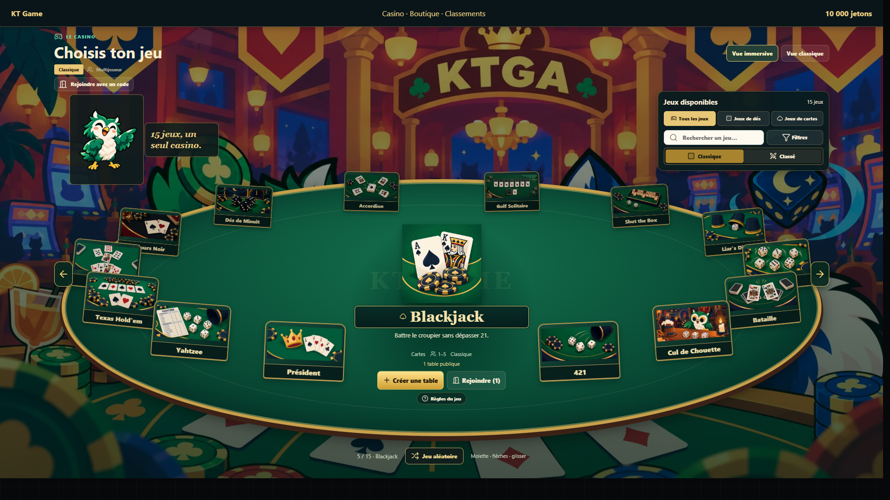
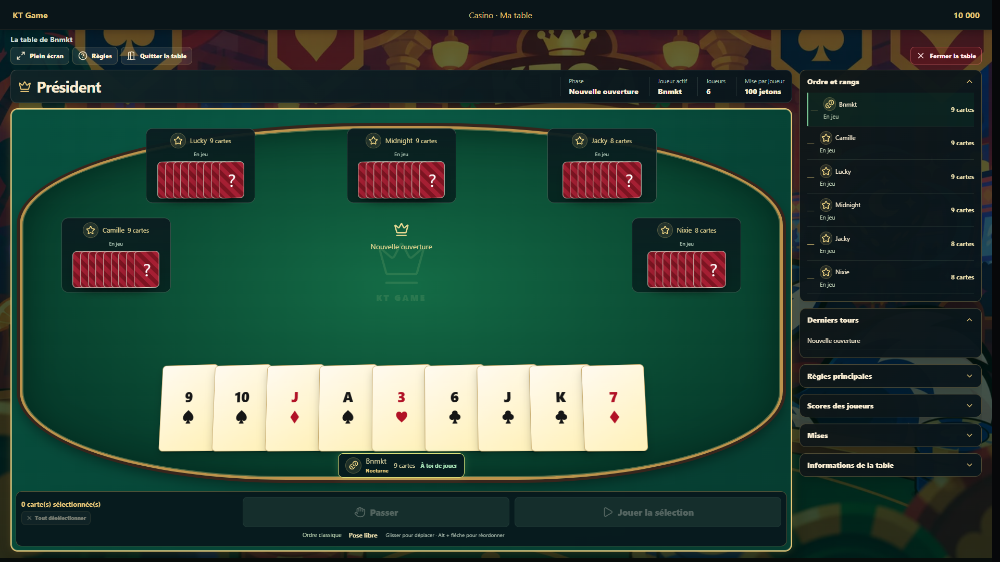
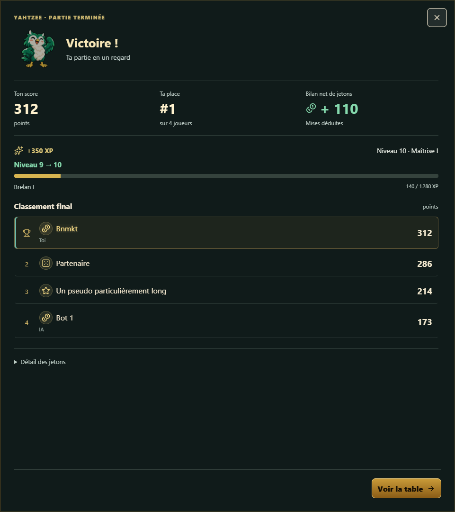
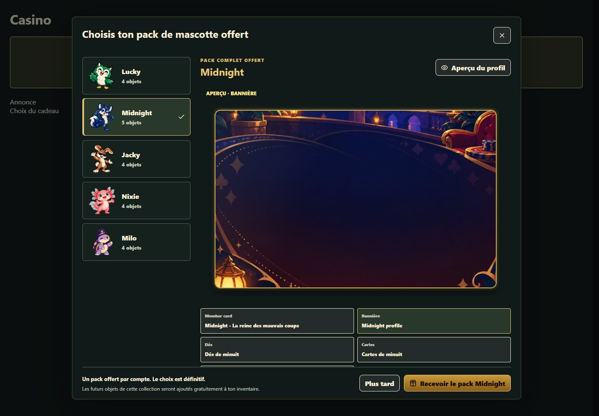

# De nouvelles tables, un compte mieux équipé et les Koins en boutique

KTGA améliore ses jeux de cartes et de dés avec une sélection immersive, six tables retravaillées et des bilans de partie en grand. Le compte accueille la connexion Discord et les clés d’accès, tandis qu’un pack de mascotte est offert à chaque compte. La boutique distingue Jetons et Koins : les Koins attribués peuvent être dépensés, mais leur achat reste fermé. Ils sont actuellement accordés uniquement en récompense de tests, à la discrétion de l’administration.

## Récapitulatif des changements

### Ajouts

- Nouvelle vue immersive pour parcourir les 15 jeux, avec recherche, filtres et accès à la création ou à la recherche d’une table.
- Distribution animée et rangement manuel de la main au Président.
- Connexion avec Discord et gestion des clés d’accès depuis le compte.
- Pack de mascotte offert à choisir une seule fois par compte.
- Portefeuille Koins et prix en Jetons et/ou en Koins sur les articles concernés.
- Nouveaux réglages audio et installation du site comme application sur les appareils compatibles.

### Améliorations

- Interfaces retravaillées pour Farkle, Yahtzee, Cul de Chouette, Texas Hold’em, Blackjack et Président.
- Surface de jeu agrandie, joueur actif mieux signalé et panneaux secondaires repliables.
- Dés et cartes en 3D plus lisibles, avec conservation des cosmétiques équipés.
- Bilan automatique sur toute la hauteur de l’écran, en classique comme en classé.
- Navigation, scores et commandes mieux adaptés aux petits écrans et au plein écran.
- Aperçus de cosmétiques enrichis et accès simplifié aux soldes et aux transactions.

### Suppressions et remplacements

- Suppression du tri automatique de la main du Président : le rangement reste entre vos mains.
- Suppression du défilement horizontal de cette main au profit d’une disposition qui tient dans la largeur disponible.
- Fin du bilan replié par défaut et de sa fermeture liée au délai d’affichage des résultats.
- Réduction des informations répétées autour des nouvelles tables ; les détails restent accessibles dans les panneaux.

### Corrections

- Lisibilité des valeurs des cartes du Président avec les différents thèmes : les valeurs restent au centre.
- Préservation de l’ordre choisi pour les cartes lors des mises à jour de la partie.
- Correction d’aperçus de cartes en rotation et maintien des effets cosmétiques sur les dés agrandis.
- Correction de débordements visuels et de panneaux trop serrés selon la résolution.
- Séparation des jetons de démonstration des invités et des soldes des comptes inscrits.
- Nettoyage des tables inactives pour éviter de laisser des salons abandonnés ouverts.

## Un casino plus immersif pour choisir son jeu

### Les 15 jeux autour de la table

La nouvelle vue du [casino](https://www.ktga.me/) présente les jeux autour d’une grande table. Le jeu sélectionné est mis en avant au centre avec son illustration, ses informations et les actions pour créer une table ou rejoindre celles qui sont disponibles.

La recherche et les filtres permettent toujours de trouver rapidement un jeu de cartes ou de dés. Vous pouvez aussi conserver la **vue classique** si vous préférez parcourir le catalogue de cette manière. Les deux présentations donnent accès aux mêmes jeux et aux mêmes tables.

*La vue immersive réunit le choix du jeu, ses informations et les accès aux tables. La vue classique reste disponible.*

## Des tables qui donnent plus de place au jeu

### Farkle, Yahtzee et Cul de Chouette

Les tables de [Farkle](https://www.ktga.me/jeux/farkle), [Yahtzee](https://www.ktga.me/jeux/yahtzee) et [Cul de Chouette](https://www.ktga.me/jeux/cul-de-chouette) partagent une présentation plus lisible : joueur actif, scores, manche et actions principales sont mieux hiérarchisés.

La piste de dés prend davantage de place. Les sélections et les lancers restants sont mieux repérables ; les feuilles de score, aides de combinaisons et informations secondaires restent accessibles sans encombrer toute la table.

**Vos dés restent en 3D**, avec leurs thèmes, leurs effets et leurs animations. Cette refonte change la présentation, pas les règles ni les combinaisons propres à chaque jeu.

### Blackjack et Texas Hold’em : les informations à leur place

Le [Blackjack](https://www.ktga.me/jeux/blackjack) adopte une table plus marquée, avec le croupier, les mains des joueurs et les commandes de mise et de décision mieux séparés. Les cartes du croupier conservent leur révélation animée avant l’affichage du bilan.

Au [Texas Hold’em](https://www.ktga.me/jeux/texas-holdem), les places autour de la table, les cartes communes, le pot et les actions sont davantage mis en avant. Les informations de cave, de joueurs et d’historique restent consultables dans les panneaux.

Les cartes conservent leur rendu 3D et leurs cosmétiques. Les informations privées restent propres à chaque joueur : l’habillage visuel ne révèle pas les mains adverses.

## Président : votre main, votre rangement

### Toutes les cartes sur une seule ligne

La table du [Président](https://www.ktga.me/jeux/president) dispose désormais votre main en bas du plateau, sur une seule ligne. La taille et le chevauchement des cartes s’adaptent au nombre de cartes et à la largeur disponible, y compris en plein écran.

Les cartes se soulèvent au survol et la sélection reste signalée. Vous pouvez sélectionner plusieurs cartes lorsque la combinaison le permet, puis désélectionner une carte d’un second clic. **Les valeurs restent au centre**, pour garder une lecture cohérente avec les différents thèmes.

Les adversaires conservent leurs cartes face cachée et leur nombre de cartes restantes est indiqué. Au centre, les cartes jouées et la combinaison en cours restent visibles.

### Un ordre choisi par le joueur et une distribution animée

Votre main **n’est plus triée automatiquement**. Vous pouvez déplacer les cartes par glisser-déposer ; un raccourci **Alt + flèche** permet aussi de les réordonner au clavier. Le rangement choisi n’est pas remplacé à chaque mise à jour de la partie.

Au début d’une partie, la distribution est représentée depuis la pioche vers les joueurs. Vous pouvez **accélérer ou passer l’animation**. Cette présentation accompagne la distribution de la partie ; elle ne décide pas des cartes reçues. Une reconnexion restaure la main en cours sans vous faire revoir toute la distribution.

*Exemple de table de démonstration : une main sur une ligne, des valeurs centrées et le nombre de cartes de chaque adversaire.*

## Un bilan de partie ouvert, en grand

### Les résultats ne passent plus au second plan

À la fin d’une partie, le bilan s’ouvre automatiquement et occupe **toute la hauteur de l’écran**. Il reste ouvert jusqu’à ce que vous le fermiez, quittiez cet écran ou qu’une nouvelle partie démarre : la fin du délai de présentation des résultats ne le replie plus.

En classique, il rassemble le résultat, le classement, les jetons et la progression lorsque ces informations s’appliquent. En classé, le récapitulatif met en avant votre évolution de rang et de classement personnel.

Les actions restent accessibles en bas de la fenêtre, même lorsque le contenu doit défiler. Après fermeture, vous pouvez revoir le bilan. Sur les tables qui le proposent, le panneau récapitulatif est également déplié par défaut.

*Exemple de bilan de démonstration. Les scores, montants et récompenses visibles illustrent la présentation ; ils ne constituent pas un gain garanti.*

## Un compte plus simple à retrouver et à personnaliser

### Discord et clés d’accès

Vous pouvez vous connecter avec **Discord** et gérer l’association depuis votre [compte](https://www.ktga.me/profil). Les options de présence Discord permettent aussi de choisir ce que vous souhaitez partager sur votre activité de jeu.

Les **clés d’accès**, également appelées *passkeys*, ajoutent une autre façon de vous connecter avec un appareil compatible, par exemple avec son déverrouillage habituel. Vous pouvez les ajouter, les renommer ou les supprimer depuis le compte. Leur disponibilité dépend du navigateur et de l’appareil ; leur gestion se fait sur le site en HTTPS, hors de l’activité intégrée Discord.

Les joueurs qui utilisent l’activité Discord disposent également d’une interface adaptée à cet affichage. Ces accès ne remplacent pas votre progression : vous retrouvez celle du compte avec lequel vous êtes connecté.

### Un pack de mascotte offert par compte

Chaque compte inscrit peut choisir **un pack de mascotte offert**, parmi les collections proposées. L’aperçu permet de regarder les objets et leur rendu sur le profil avant de confirmer.

**Le choix est définitif et ne peut être fait qu’une seule fois par compte.** Les objets de la collection choisie sont ajoutés à votre inventaire ; les futurs objets ajoutés à cette même collection seront également accordés gratuitement.

Vous pouvez ensuite équiper vos éléments depuis le [profil](https://www.ktga.me/profil) et retrouver les autres collections dans la [boutique](https://www.ktga.me/shop). Le contenu dépend de la collection proposée ; ce cadeau n’est pas une attribution de Koins.

*L’aperçu aide à choisir sa collection. Un seul pack est offert par compte et le choix est définitif.*

## Jetons et Koins : deux usages à distinguer

### Des prix plus clairs et un portefeuille accessible

La [boutique](https://www.ktga.me/shop) affiche les prix en **Jetons et/ou en Koins**, selon les articles et les moyens de dépense proposés. Les aperçus permettent de regarder les cosmétiques avant de choisir.

Les soldes sont regroupés dans la navigation, et le [portefeuille Koins](https://www.ktga.me/profil?koins=1) permet de consulter son solde et les opérations associées. Le profil conserve aussi le journal de transactions de Jetons.

| Monnaie | À quoi sert-elle ? |
| --- | --- |
| **Jetons** | Monnaie de jeu utilisée dans les mises des parties concernées et pour les articles qui proposent ce prix. |
| **Koins** | Monnaie destinée aux cosmétiques qui proposent un prix en Koins. Elle ne sert pas à miser dans les parties. |

Les Koins ne donnent pas un avantage dans les règles du jeu. Ils ne sont pas échangeables contre des Jetons ni convertibles en argent.

### Les Koins sont dépensables, leur achat reste fermé

**Les Koins déjà présents sur votre compte peuvent être dépensés dans la boutique pour les cosmétiques concernés. L’achat de Koins reste bloqué pour le moment.**

Actuellement, **la seule méthode pour obtenir des Koins est une attribution de l’administration en récompense de tests**, à son bon vouloir. Il ne s’agit ni d’un gain automatique en jouant ni d’une récompense promise pour chaque test.

L’administration décide des attributions. Aucune date d’ouverture des achats ni aucun montant de récompense systématique n’est annoncé dans cette mise à jour.

### Les jetons de démonstration restent séparés

Les invités peuvent découvrir les jeux avec leurs jetons de démonstration. Ces jetons sont désormais clairement séparés de l’économie des comptes inscrits : ils ne doivent pas être présentés comme un dépôt d’un joueur inscrit ou un gain récupérable sur son compte.

Cette correction rend les mises et les résultats plus cohérents lorsque des comptes inscrits, des invités ou des bots se retrouvent autour d’une table. Elle ne crée pas de conversion des jetons de démonstration en Koins.

## Plus de confort au quotidien

### Mobile, installation et ambiance sonore

La navigation mobile et les raccourcis de table donnent un accès plus direct aux scores et aux informations utiles. Les panneaux repliables et le plein écran permettent de consacrer davantage d’espace au jeu.

Sur les appareils compatibles, KTGA peut être **installé comme une application depuis le navigateur**. Une connexion reste nécessaire pour participer aux parties en ligne. Les réglages audio permettent de choisir les volumes de l’ambiance et des effets de jeu.

Les tables abandonnées sont aussi mieux nettoyées : les salons inactifs ne doivent plus rester ouverts indéfiniment. Pour retrouver les règles et les repères de navigation, consultez le [guide du joueur](https://www.ktga.me/guide) ou la [FAQ](https://www.ktga.me/faq).

**Merci à toutes les personnes qui testent KTGA.** Si vous rencontrez un problème, le [suivi des bugs](https://www.ktga.me/bugs) permet de le signaler. Précisez le jeu, ce que vous faisiez et, pour un souci d’affichage, l’appareil ou la taille de l’écran. Cela nous aide à retrouver la situation et à corriger ce qui gêne vos parties.

Retrouvez aussi la [version 0.2.1](https://www.ktga.me/patchnotes?version=0.2.1) pour les nouveautés du classé et des maîtrises, et [l’ensemble des jeux](https://www.ktga.me/jeux) pour choisir votre prochaine table.
